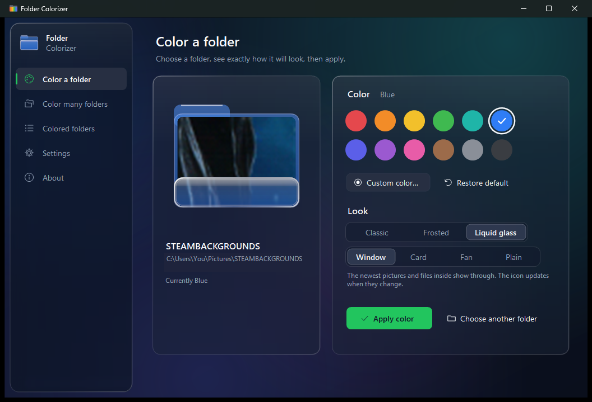
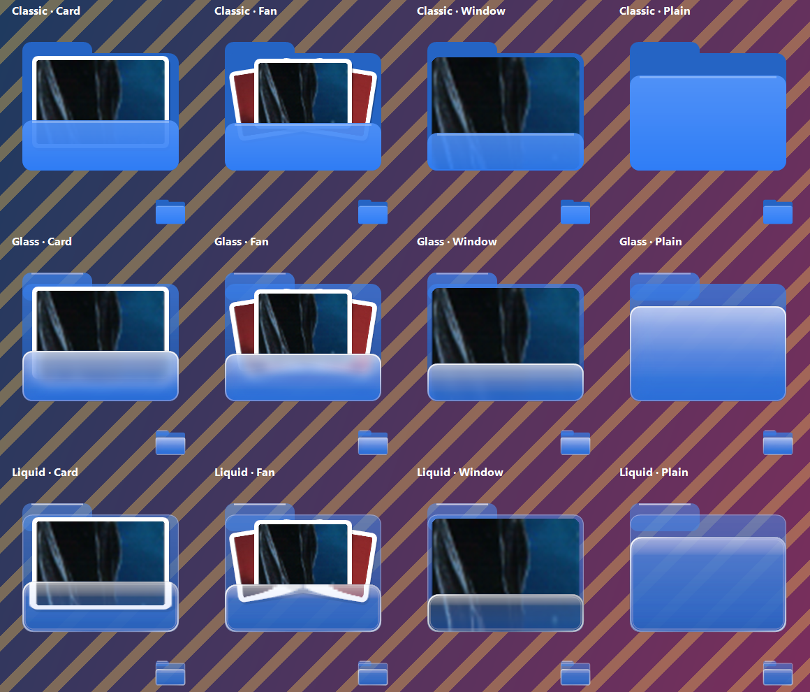
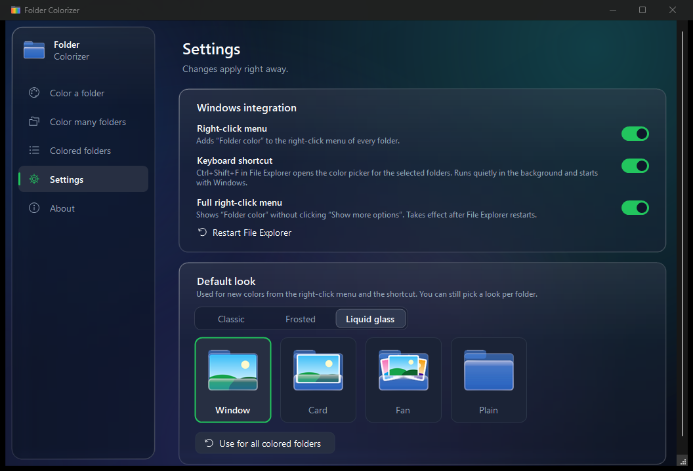

# Folder Colorizer

Give any folder on Windows 11 a color, from its right-click menu or with a keyboard shortcut. A colored folder can also show the newest pictures and files inside it, the way Windows does for normal folders.



## Download

Get `FolderColorizer-Setup-x.y.z.exe` from the [latest release](../../releases/latest). Each installer is built from this source code by GitHub Actions, and the release lists its SHA-256 checksum.

- Windows 10 or 11, 64-bit. Nothing else needed (.NET is included).
- Installs for your user only, with no admin prompt.
- The installer isn't code-signed yet, so Windows SmartScreen may say "Windows protected your PC". Click **More info**, then **Run anyway**.

## Three ways to color a folder

1. Right-click a folder, then **Folder color** (on Windows 11 it's under **Show more options**, or you can turn on the full menu in Settings).
2. Select folders in File Explorer and press **Ctrl+Shift+F**. A small picker opens; press **1** to **0** for a color, **C** for a custom color, **R** to restore.
3. Open **Folder Colorizer** from the Start menu, then drop a folder on the window or browse to one. You see the exact icon before you apply it.

12 colors are built in, and any custom color works too. **Restore default** puts the normal Windows folder back.

## File previews

Colored folders can show the newest photos, videos and files inside them. Pick the look in Settings:



**Window** (picture fills the folder), **Card**, **Fan** (up to three files), or **Plain** (color only). The background app redraws a folder's icon a moment after its files change.



## How it works

Folder Colorizer uses the same mechanism as **Properties → Customize → Change Icon** in File Explorer: it writes a `desktop.ini` into the folder and sets the icon through the Windows shell. Nothing about the folder's contents changes.

- Icons are generated on your PC and kept in `%LOCALAPPDATA%\FolderColorizer\icons`. Unused ones are removed automatically.
- The right-click menu lives under `HKEY_CURRENT_USER\Software\Classes\Directory\shell\FolderColorizer`.
- The Ctrl+Shift+F shortcut is handled by a small background app that starts with Windows (you can turn it off in Settings). It only reacts while File Explorer is in front.
- The app makes no network connections.

Uninstall from **Settings → Apps**. It removes the menu, the shortcut and the startup entry; colored folders keep their color until you restore them.

## Build from source

Needs the [.NET 10 SDK](https://dotnet.microsoft.com/download) and [Inno Setup 6](https://jrsoftware.org/isinfo.php).

```powershell
./build-installer.ps1
```

The installer lands in `installer\`. Pushing a tag such as `v1.1.0` makes GitHub Actions build it and publish a release.

## Code signing policy

Free code signing provided by [SignPath.io](https://about.signpath.io), certificate by [SignPath Foundation](https://signpath.org) (once the project's application is approved; releases until then are unsigned).

- Committers and reviewers: [Das7ardly](https://github.com/Das7ardly)
- Approvers: [Das7ardly](https://github.com/Das7ardly)

Every release is built by [GitHub Actions](.github/workflows/release.yml) from the tagged source in this repository, and each signing request is approved by hand.

### Privacy policy

This program will not transfer any information to other networked systems unless specifically requested by the user or the person installing or operating it.

## License

[MIT](LICENSE)
